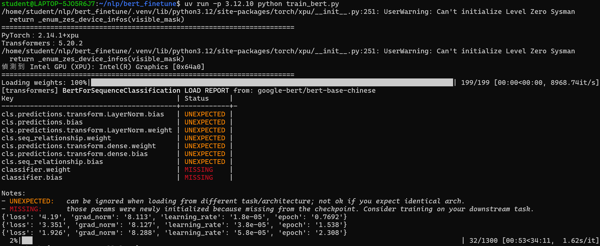
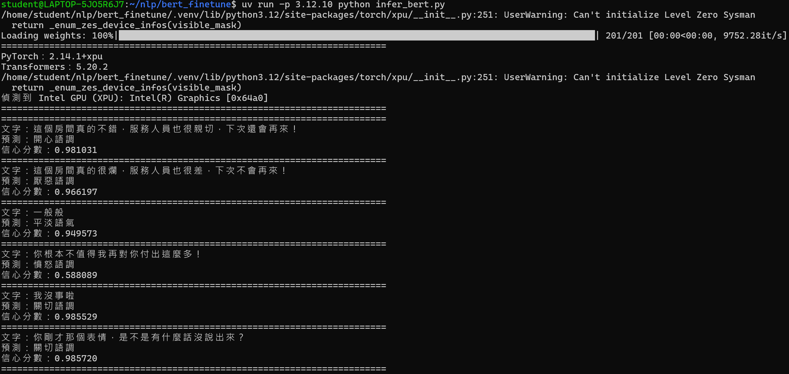

# 中文句子情緒分類

## 訓練資料來源

- [Datasets:Johnson8187/Chinese_Multi-Emotion_Dialogue_Dataset](https://huggingface.co/datasets/Johnson8187/Chinese_Multi-Emotion_Dialogue_Dataset)

## 基礎模型

- [google-bert/bert-base-chinese](https://huggingface.co/google-bert/bert-base-chinese)

## 安裝套件

### 系統環境

- WSL2 Ubuntu 26.04 LTS

### python 版本

- CPython 3.12.10

### GPU 類型

- Intel ARC 140V

### 透過 UV 安裝

```bash
uv venv --python 3.12.10
uv pip install -r requirements.txt
```

### Intel GPU 如何安裝 pytorch 可以參考我的 repo

[wsl2-docker-intel-gpu-pytorch-setup](https://github.com/jim-yc/wsl2-docker-intel-gpu-pytorch-setup)

## 說明

本專案使用 `google-bert/bert-base-chinese` 預訓練模型，針對中文情緒對話資料集進行微調，實現多元情緒分類任務。

### 情緒類別 (共 8 類)

| ID | 情緒類別 | 資料筆數 |
|----|----------|----------|
| 0  | 厭惡語調 | 404      |
| 1  | 平淡語氣 | 705      |
| 2  | 悲傷語調 | 486      |
| 3  | 憤怒語調 | 527      |
| 4  | 疑問語調 | 386      |
| 5  | 開心語調 | 592      |
| 6  | 關切語調 | 560      |
| 7  | 驚奇語調 | 499      |

**總計**: 4,159 筆資料 (訓練集: 3,327 筆 / 驗證集: 832 筆)

### 訓練參數

- **訓練回合數 (Epochs)**: 100 (Early stopping 會自動停止)
- **批次大小 (Batch Size)**: 128 (per device)
- **梯度累積步數 (Gradient Accumulation Steps)**: 2 (有效 batch size = 256)
- **學習率 (Learning Rate)**: 1e-4
- **預熱步數 (Warmup Steps)**: 50
- **權重衰減 (Weight Decay)**: 0.01
- **最大序列長度 (Max Sequence Length)**: 512
- **學習率調度器 (LR Scheduler)**: linear
- **評估指標 (Metric)**: Weighted F1 Score
- **隨機種子 (Random Seed)**: 42

### 預測結果

```
這個房間真的不錯，服務人員也很親切，下次還會再來！ => 開心語調 (0.98)
這個房間真的很爛，服務人員也很差，下次不會再來！ => 厭惡語調 (0.97)
一般般 => 平淡語氣 (0.95)
你根本不值得我再對你付出這麼多！ => 憤怒語調 (0.59)
我沒事啦 => 關切語調 (0.99)
你剛才那個表情，是不是有什麼話沒說出來？ => 關切語調 (0.99)
```

## 執行方法

### 檔案結構

```
├── data/bert                 # 訓練和驗證資料
│   ├── train.jsonl           # 訓練資料
│   └── valid.jsonl           # 驗證資料
│
├── output/bert_binary_clf    # 微調後的模型檔案
│   ├── config.json           # 模型配置
│   ├── model.safetensors     # 模型權重
│   ├── tokenizer_config.json # 分詞器配置
│   ├── tokenizer.json        # 分詞器
│   ├── trainer_state.json    # 訓練狀態
│   └── training_args.bin     # 訓練參數
│
├── prepare_data.py           # 準備資料
├── train_bert.py             # 模型微調
├── infer_bert.py             # 模型推論
├── data.csv                  # 原始資料
├── requirements.txt          # 套件列表
├── .gitattributes            # Git LFS 設定
├── .gitignore                # Git 忽略清單
└── README.md                 # 專案說明文件
```

### 準備資料

```bash
uv run -p 3.12.10 python prepare_data.py
```

### 微調模型

```bash
uv run -p 3.12.10 python train_bert.py
```

### 模型推論

```bash
uv run -p 3.12.10 python infer_bert.py
```

## 成果

### 訓練



### 推論

